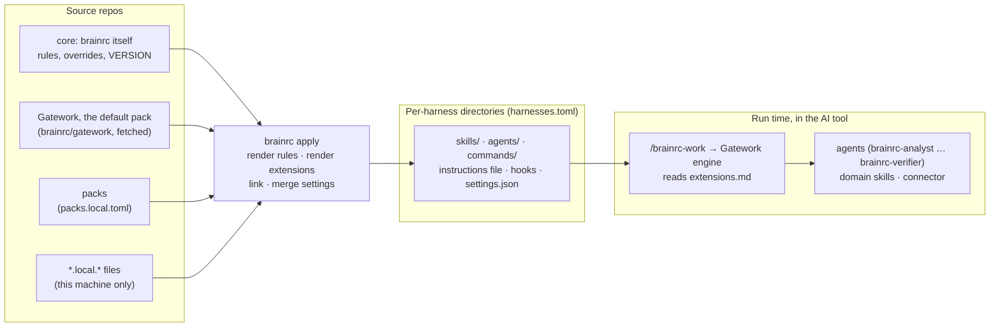

# Architecture

How brainrc is built, for contributors and the curious. It has two moments. At install time,
`brainrc apply` turns sources (brainrc itself and the packs) into files each AI tool reads. At run
time, the tool loads those files, and Gatework drives a ticket through them.



## Install time vs run time

| When | Step | Reads | Writes |
|---|---|---|---|
| install | `brainrc validate` | every source, `VERSION`, `CHANGELOG.md` | nothing |
| install | render rules | `rules/*.md` from core, then each pack, then `*.local.md` | `$BRAINRC_HOME/instructions.md` (default `~/.config/brainrc/`) |
| install | render extensions | each enabled pack's `pack.toml`, through Gatework's validator plugin | `$BRAINRC_HOME/extensions.md` (only while Gatework is enabled) |
| install | link and merge | `harnesses.toml`, `overrides/<harness>/` | symlinks in each harness dir, hook entries in its settings file |
| run | every session | the instructions file, skill descriptions | nothing |
| run | `/brainrc-work <ticket>` | `extensions.md`, the connector, agents, domain skills | `specs/<slug>/` in your project, commits on a feature branch |
| run | every tool call (Claude Code) | guard hooks | an allow, ask, or deny decision |

Skills, agents, commands, and hooks are symlinks, so `git pull` updates them at once. Rules and
extensions are rendered, so re-run `apply` after changing them or enabling a pack.

The code is the `brainrc/` package (`python3 scripts/brainrc.py` or `python3 -m brainrc`), stdlib
only. The main modules: `cli` (the commands), `config` (config files and paths), `sources` and
`packs` (reading and fetching packs), `adapters/` (one module per tool: what its content looks
like, [adapters](adapters.md)), `plan` and `settings` (links and merges), `project`, `lock`
and `frozen` (project scope and the lockfile), `mcp` and `mcp_pins`, `validate`, `doctor`,
`audit`, `importers/`, and `plugin` (the plugin manifests).

## Glossary

- **Harness**: an AI coding tool brainrc syncs into: Claude Code, Codex, OpenCode, Antigravity CLI, Cursor ([support](capabilities.md)).
- **Core**: brainrc's own repo. Generic content only, versioned by `VERSION` ([CHANGELOG](../CHANGELOG.md)).
- **Pack**: a folder or repo layered on core for content that doesn't belong in it ([packs](packs.md)).
- **Default pack**: a pack core's `packs.toml` turns on: Gatework, which holds its engine, its agents and the domain skills ([packs](packs/use-a-pack.md#turn-the-default-pack-off-or-pin-it)).
- **Official pack**: a pack the brainrc project publishes under a `brainrc/` ID. Gatework has a repo of its own; the others are folders of [brainrc/packs](https://github.com/brainrc/packs), enabled with `subdir` ([list](packs.md#naming)).
- **Skill**: instructions a tool loads on demand, triggered by its description ([format](formats.md#skills-skillsnameskillmd)).
- **Domain skill**: a skill for one stack (Terraform, Kubernetes, ...) that Gatework loads only when the ticket touches it. Gatework ships some and the official packs add more ([list](gatework.md#domain-skills)).
- **Agent**: one role in a Gatework run, such as analyst or verifier ([roles](gatework.md#roles)).
- **Connector**: the skill Gatework uses to read and update a ticket system ([contract](https://github.com/brainrc/gatework/blob/main/skills/brainrc-gatework/references/connectors.md)).
- **Gate**: a stop where you approve the spec, the plan, or delivery ([Gatework](gatework.md)).
- **`requires_api`**: the pack API versions a pack supports ([compatibility](packs.md#compatibility)).
  `requires_core`, which pins core's own version, is deprecated.

## Repository layout

```
rules/          brainrc's own rules, as ordered markdown (00-core.md, 10-git.md, ...)
overrides/      per-tool guard hooks and settings fragments (Claude Code, Cursor, OpenCode)
mcp/            core's MCP server registry (empty: servers come from packs)
harnesses.toml  where each tool reads each kind of content
packs.toml      the default pack, Gatework, pinned to a release
brainrc/        the Python package behind the `brainrc` command (stdlib only, Python 3.11+)
scripts/        brainrc.py (runs the package from a clone), evals, release and CI checks
tests/          unittest suites for the package and the hooks
evals/          eval cases that grade Gatework runs (docs/evals.md)
docs/           this site (MkDocs), plus the JSON Schemas in docs/schemas/
examples/       example packs (pack-acme, pack-homelab) and a sandbox repo for trying Gatework
dev/specs/      the records of Gatework runs that built brainrc
changelog.d/    one fragment per unreleased change, folded into CHANGELOG.md on release
VERSION         the core version (packs pin the pack API in brainrc/packapi.py instead)
```

`.claude-plugin/`, `.cursor-plugin/`, `plugin.json` and `package.json` are generated by
`python3 scripts/brainrc.py plugin`; don't edit them by hand.
