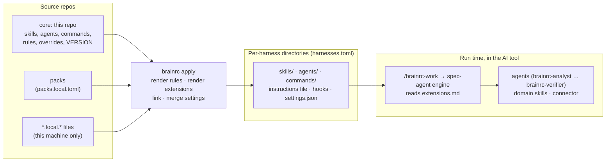

# Architecture

brainrc has two moments. At install time, `brainrc apply` turns source repos into files each AI
tool reads. At run time, the tool loads those files, and spec-agent drives a ticket through them.

## Install time vs run time

| When | Step | Reads | Writes |
|---|---|---|---|
| install | `brainrc validate` | every source, `VERSION`, `CHANGELOG.md` | nothing |
| install | render rules | `rules/*.md` from core, then each pack, then `*.local.md` | `$BRAINRC_HOME/instructions.md` (default `~/.config/brainrc/`) |
| install | render extensions | each enabled pack's `pack.toml` | `$BRAINRC_HOME/extensions.md` (and, deprecated, `skills/spec-agent/references/extensions.md`) |
| install | link and merge | `harnesses.toml`, `overrides/<harness>/` | symlinks in each harness dir, hook entries in its settings file |
| run | every session | the instructions file, skill descriptions | nothing |
| run | `/brainrc-work <ticket>` | `extensions.md`, the connector, agents, domain skills | `specs/<slug>/` in your project, commits on a feature branch |
| run | every tool call (Claude Code) | guard hooks | an allow, ask, or deny decision |

Skills, agents, commands, and hooks are symlinks, so `git pull` updates them at once. Rules and
extensions are rendered, so re-run `apply` after changing them or enabling a pack.

The code is the `brainrc/` package (`python3 scripts/brainrc.py` or `python3 -m brainrc`), one module
per stage: `config`, `sources`, `opencode`, `plan`, `settings`, `plugin`, `tokens`, `validate`,
`doctor`, and `cli` for the commands.

## Glossary

- **Harness**: an AI coding tool brainrc syncs into: Claude Code, Codex, OpenCode, Antigravity CLI, Cursor ([support](formats.md#harness-support)).
- **Core**: this repo. Generic content only, versioned by `VERSION` ([CHANGELOG](../CHANGELOG.md)).
- **Pack**: a separate repo layered on core for content that can't live here ([packs](packs.md)).
- **Skill**: instructions a tool loads on demand, triggered by its description ([format](formats.md#skills-skillsnameskillmd)).
- **Domain skill**: a skill for one stack (Terraform, Kubernetes, ...) that spec-agent loads only when the ticket touches it ([list](spec-agent.md#domain-skills-skills)).
- **Agent**: one role in a spec-agent run, such as analyst or verifier ([roles](spec-agent.md#roles-agents)).
- **Connector**: the skill spec-agent uses to read and update a ticket system ([contract](../packs/gatework/skills/spec-agent/references/connectors.md)).
- **Gate**: a stop where you approve the spec, the plan, or delivery ([spec-agent](spec-agent.md)).
- **`requires_core`**: the core versions a pack supports ([compatibility](packs.md#compatibility)).
